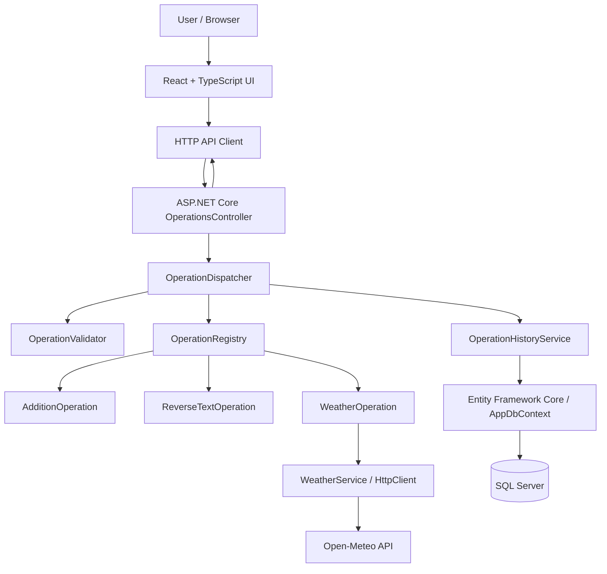
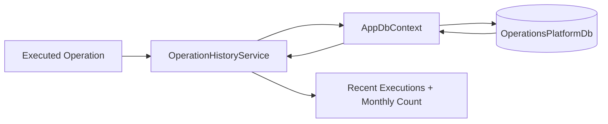
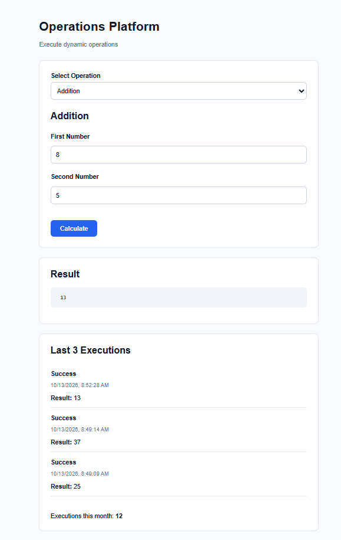
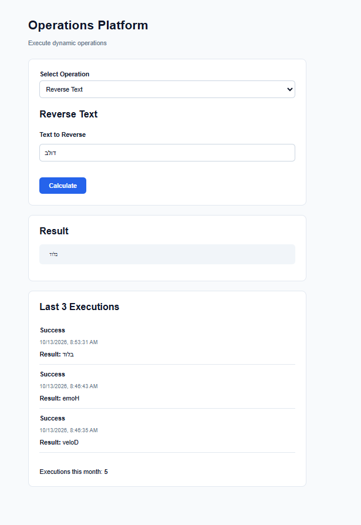
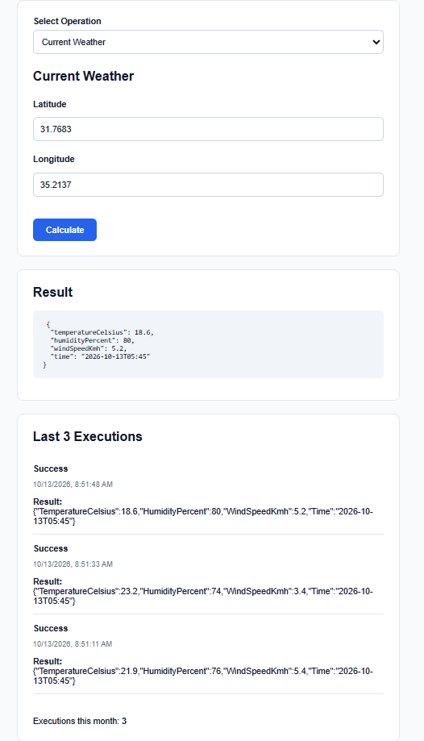

# Operations Platform

**Full-stack operations execution platform** built with **ASP.NET Core 10, React, TypeScript, SQL Server, and Entity Framework Core**.

The application allows users to discover available operations, provide inputs through a dynamically generated form, execute an operation, inspect the result, and review recent execution history and monthly usage. The backend is structured around independently implemented operations rather than hard-coded operation logic in the HTTP controller.

## Table of Contents

- [Overview and Features](#overview-and-features)
- [Architecture](#architecture)
- [Backend Design](#backend-design)
- [Frontend Design](#frontend-design)
- [Database Design](#database-design)
- [API Contract](#api-contract)
- [Validation, Error Handling, and Logging](#validation-error-handling-and-logging)
- [Testing](#testing)
- [Project Structure](#project-structure)
- [Running Locally](#running-locally)
- [Screenshots](#screenshots)
- [Design Decisions and Trade-offs](#design-decisions-and-trade-offs)

## Overview and Features

The system currently supports three operations:

| Operation ID | Description | Parameters |
| --- | --- | --- |
| `addition` | Adds two numeric values | `value1`, `value2` |
| `reverse-text` | Reverses a string, with Unicode-aware handling | `text` |
| `weather` | Fetches current weather for geographic coordinates from Open-Meteo | `latitude`, `longitude` |

Additional capabilities:

- **Backend-driven operation definitions:** the API describes each operation and its required inputs; the UI renders the appropriate fields.
- **Execution history:** completed executions are persisted using Entity Framework Core and SQL Server.
- **Recent activity:** the application displays the latest three executions.
- **Monthly usage:** execution totals are calculated for the current month.
- **Centralized validation and error handling:** invalid inputs return structured HTTP errors.
- **Request/response and error logging:** Serilog records application diagnostics in rolling files.
- **Automated unit tests:** xUnit tests cover core operation behavior.

## Architecture

The project is a **monorepo** with three separate concerns: the React client, ASP.NET Core Web API, and automated backend tests. SQL Server is the persistence layer; Open-Meteo is an external dependency used only by the weather operation.



### Typical execution flow

1. The React application requests `GET /api/operations`.
2. The backend returns operation metadata, including parameter names, types, labels, and required flags.
3. The frontend builds a form for the selected operation without needing a separate hard-coded form for every operation.
4. The user submits the form to `POST /api/operations/execute`.
5. The backend resolves the operation, validates its parameters, and executes the appropriate implementation.
6. For weather requests, `WeatherService` calls the external Open-Meteo API through a configured `HttpClient`.
7. The backend persists execution information through the history service and EF Core.
8. The response is presented in the UI along with recent history and monthly usage information.

This separation keeps presentation, HTTP handling, operation execution, and persistence responsibilities distinct.

## Backend Design

**Stack:** C#, .NET 10, ASP.NET Core Web API, Entity Framework Core, SQL Server provider, `HttpClient`, and Serilog.

### HTTP and application layers

| Component | Responsibility |
| --- | --- |
| `Controllers/OperationsController.cs` | Exposes the operations endpoints and delegates application behavior to services. |
| `Contracts/` | Defines request/response contracts and validation-related types. |
| `Services/OperationRegistry.cs` | Makes available operation implementations discoverable by ID. |
| `Services/OperationValidator.cs` | Validates input parameters against the operation's requirements. |
| `Services/OperationDispatcher.cs` | Coordinates selecting, validating, and executing an operation. |
| `Services/OperationHistoryService.cs` | Handles persistence and retrieval of execution statistics/history. |
| `Services/WeatherService.cs` | Encapsulates calls to the external weather API. |
| `Operations/` | Contains the operation interface, parameter definitions, and individual implementations. |
| `Exceptions/GlobalExceptionHandler.cs` | Converts application exceptions into consistent HTTP error responses. |
| `Middleware/RequestResponseLoggingMiddleware.cs` | Logs HTTP request/response information and request duration. |
| `Program.cs` | Registers dependencies and configures middleware, EF Core, CORS, Swagger, and logging. |

### Extensible operation model

The operation implementations are kept separate:

- `AdditionOperation` — numeric addition.
- `ReverseTextOperation` — text reversal with attention to Unicode handling.
- `WeatherOperation` — coordinate-based current-weather lookup.

They follow a shared `IOperation` abstraction and expose parameter metadata. Adding another operation primarily involves implementing the operation contract and registering the new implementation in dependency injection. The existing UI can then use the metadata returned by the API to render the appropriate fields.

### Dependency injection and external requests

Services and operations are registered through ASP.NET Core's built-in dependency injection container. `WeatherService` uses a configured `HttpClient` with Open-Meteo as its base address and a request timeout. This keeps HTTP integration concerns outside the controller and operation orchestration code.

## Frontend Design

**Stack:** React, TypeScript, Vite, and CSS.

The frontend separates API communication, reusable components, application types, and stateful behavior:

| File / Area | Responsibility |
| --- | --- |
| `src/api/operationsApi.ts` | Communicates with the backend API. |
| `src/hooks/useOperations.ts` | Coordinates operation-related data and UI behavior. |
| `src/types/operation.ts` | Defines TypeScript models for operation data. |
| `src/components/OperationSelector.tsx` | Allows the user to choose an operation. |
| `src/components/OperationForm.tsx` | Renders input controls from the selected operation's parameter metadata. |
| `src/components/OperationResult.tsx` | Displays the result of the executed operation. |
| `src/components/OperationHistory.tsx` | Presents execution history. |
| `src/App.tsx` | Composes the main application interface. |

### Dynamic forms

Rather than defining an unrelated form for each operation, the client consumes metadata from the backend, for example:

```json
{
  "id": "addition",
  "name": "Addition",
  "parameters": [
    { "name": "value1", "label": "First Number", "type": "number", "required": true },
    { "name": "value2", "label": "Second Number", "type": "number", "required": true }
  ]
}
```

This metadata-driven approach reduces duplication and allows the backend to remain the source of truth for supported operations and parameter definitions.

## Database Design

**Database:** Microsoft SQL Server Express for local development. **Data access:** Entity Framework Core 10 using the SQL Server provider.

The persistence layer is organized around:

- `Data/AppDbContext.cs` — EF Core context and database access.
- `Models/OperationExecution.cs` — entity representing a recorded operation execution.
- `Migrations/` — checked-in EF Core migration and model snapshot for reproducible database setup.
- `Services/OperationHistoryService.cs` — application-level access to recent executions and monthly counts.

### Persistence workflow



The application stores execution records so history survives application restarts. The history service retrieves the **three most recent executions** and computes the **current month's execution count** from persisted records. The exact database schema is defined in `OperationExecution` and the included EF Core migration.

The repository includes the migration files, **not a database backup**. Reviewers create the schema locally by applying the migration.

## API Contract

Base URL when running locally with the HTTPS launch profile: `https://localhost:7170`.

| Method | Endpoint | Purpose |
| --- | --- | --- |
| `GET` | `/api/operations` | Returns supported operations and parameter metadata. |
| `POST` | `/api/operations/execute` | Validates and executes a requested operation. |

### Example: addition

```http
POST /api/operations/execute
Content-Type: application/json
```

```json
{
  "operationId": "addition",
  "parameters": {
    "value1": 10,
    "value2": 5
  }
}
```

### Example: reverse text

```json
{
  "operationId": "reverse-text",
  "parameters": {
    "text": "Hello"
  }
}
```

### Example: current weather

```json
{
  "operationId": "weather",
  "parameters": {
    "latitude": 32.0853,
    "longitude": 34.7818
  }
}
```

Weather uses geographic coordinates rather than a city name. It requires internet access to the [Open-Meteo API](https://open-meteo.com/).

In the Development environment, interactive Swagger documentation is available at `https://localhost:7170/swagger`.

## Validation, Error Handling, and Logging

### Validation and errors

- Operation inputs are checked on the backend, not only in the UI.
- Invalid parameters produce **HTTP 400** responses with structured validation details.
- Unexpected exceptions are handled centrally by `GlobalExceptionHandler` rather than being left to individual controllers.
- ASP.NET Core `ProblemDetails`-style responses provide consistent error information.

For example, supplying a nonnumeric `value1` for addition returns a validation error instead of executing the operation.

### Logging

Serilog is configured in `Program.cs`, with a custom HTTP logging middleware and separate rolling log files:

```text
logs/requests-YYYYMMDD.log
logs/errors-YYYYMMDD.log
```

Request logs capture HTTP request/response information and execution duration; error logs capture error-level events. Generated logs are excluded from version control via `.gitignore`.

## Testing

The repository includes an **xUnit** test project under `tests/OperationsPlatform.Tests/`.

- `AdditionOperationTests.cs` — tests for the addition operation.
- `ReverseTextOperationTests.cs` — tests for text reversal.

Run the test suite from the repository root:

```powershell
dotnet test .\tests\OperationsPlatform.Tests\OperationsPlatform.Tests.csproj
```

These are backend unit tests; they do not replace end-to-end testing of the frontend, database, and external weather API.

## Project Structure

```text
Operations_Platform_Assignment/
├── backend/
│   ├── Contracts/                 # API contracts
│   ├── Controllers/               # HTTP endpoints
│   ├── Data/                      # EF Core DbContext
│   ├── Exceptions/                # Global exception handling
│   ├── Middleware/                # HTTP request/response logging
│   ├── Migrations/                # Database schema migrations
│   ├── Models/                    # Persistence entities
│   ├── Operations/                # IOperation and implementations
│   ├── Services/                  # Dispatch, validation, history, weather
│   ├── Properties/launchSettings.json
│   ├── appsettings.json
│   └── Operations_Platform_Assignment.csproj
├── frontend/
│   ├── public/
│   ├── src/
│   │   ├── api/
│   │   ├── components/
│   │   ├── hooks/
│   │   ├── types/
│   │   └── App.tsx
│   └── package.json
├── tests/
│   └── OperationsPlatform.Tests/
├── screenshots/                  # Application screenshots (add locally)
├── README.md
└── Operations_Platform_Assignment.slnx
```

## Running Locally

### Prerequisites

- [.NET 10 SDK](https://dotnet.microsoft.com/download/dotnet/10.0)
- [Node.js](https://nodejs.org/) and npm
- SQL Server Express (or another compatible SQL Server instance)
- Internet connection for weather requests
- Optional: Visual Studio / VS Code

### 1. Clone the repository

```powershell
git clone https://github.com/DolevPeretz/Operations-Platform.git
cd Operations-Platform
```

### 2. Configure SQL Server

Make sure SQL Server Express is installed and its service is running. The local connection string in `backend/appsettings.json` is:

```json
{
  "ConnectionStrings": {
    "DefaultConnection": "Server=localhost\\SQLEXPRESS;Database=OperationsPlatformDb;Trusted_Connection=True;TrustServerCertificate=True;"
  }
}
```

This example uses Windows authentication. Adjust the server/instance name if your local setup differs. Never commit real credentials.

Install the EF Core CLI if it is not already available:

```powershell
dotnet tool install --global dotnet-ef --version 10.0.12
```

Apply the existing migration from the repository root:

```powershell
dotnet ef database update --project .\backend\Operations_Platform_Assignment.csproj --startup-project .\backend\Operations_Platform_Assignment.csproj
```

### 3. Start the backend

In **terminal 1**, from the repository root:

```powershell
cd .\backend
dotnet run --launch-profile https
```

Development URLs from `launchSettings.json`:

- `https://localhost:7170`
- `http://localhost:5247`

Verify the operation list at **https://localhost:7170/api/operations** and Swagger at **https://localhost:7170/swagger**.

If needed, trust the local development HTTPS certificate:

```powershell
dotnet dev-certs https --trust
```

### 4. Start the frontend

In **terminal 2**, from the repository root:

```powershell
cd .\frontend
npm.cmd ci
npm.cmd run dev
```

Open **http://localhost:5173**.

> The frontend's API endpoint is configured in `frontend/src/api/operationsApi.ts`. If the backend URL changes, update that configuration. The backend's CORS policy in `Program.cs` currently allows the local Vite origin `http://localhost:5173`.

### 5. Verify the application

1. Select **Addition**, enter two numbers, and check the result.
2. Select **Reverse Text** and submit a sample string.
3. Select **Current Weather**, enter latitude and longitude (e.g. Tel Aviv: `32.0853`, `34.7818`), and verify the weather result.
4. Confirm that the recent history and monthly execution count update as operations run.
5. Run the xUnit tests using the command in the [Testing](#testing) section.

## Screenshots

Save screenshots in the root-level `screenshots/` directory. The links below assume these filenames; rename the files or adjust the Markdown paths as needed.


### Addition



### Reverse text



### Current weather




- **Metadata-driven UI:** the frontend derives input fields from API metadata, reducing duplicated operation-specific UI code.
- **Separation of responsibilities:** the controller handles HTTP, the dispatcher coordinates execution, each operation implements its own behavior, and a dedicated service manages persistence.
- **Extensibility:** new operations can be added through the shared interface and dependency-injection registration, rather than extending a single large conditional controller.
- **EF Core migrations:** the schema can be reproduced without distributing local database files.
- **Centralized validation and exception handling:** consistent errors make the API easier to consume and maintain.
- **Local-first submission:** the complete assignment runs locally with SQL Server Express; no cloud account or paid infrastructure is needed to review it.


